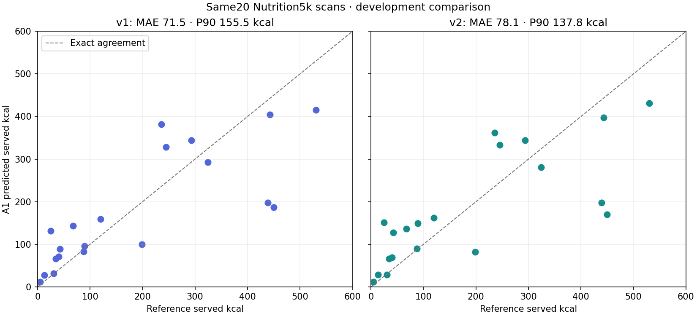

# Nutrient-catalog candidate: actual development comparison

The73-record candidate was implemented and measured; **it is not promoted to the deployed callable**. Better nutrient attribution did not establish a calorie-accuracy gain on this run. No phone installation is required for these engineering checks.

All20 original Nutrition5k JPEGs, reference labels, selection and input hashes were reused unchanged. Candidate source `842b208b66bca5a68b255eb1d5d4d8823cc6a8d4` made exactly20 SDK requests:20 valid estimates,zero failures/retries/fallbacks/questions. Model remains `gemini-3.8-flash`, Vertex US, LOW,8192output cap,30s timeout, SDK2.19.0. The catalog and resulting allowed-ID prompt/schema changed; single stochastic calls can also change recognition/portions. This is a **reused development comparison**, not an isolated causal test or new heldout validation.

| Observed metric | Original6 records | Candidate73 records |
|---|---:|---:|
| A1 valid responses |20/20|20/20|
| A1 served-kcal MAE |71.54|78.05|
| A1 signed kcal bias |−7.77|−4.75|
| A1 P90 absolute kcal error |155.45|137.80|
| A1 normalized absolute error, floor200kcal |24.89%|27.99%|
| Portion-mass MAE, g |49.60|50.45|
| Protein/carbs/fat MAE, g |5.43/5.10/4.72|6.19/5.75/4.79|
| A0 full-image catalog coverage |1/20|6/20|
| Database-matched predicted components |6/39|25/43|
| Energy from unverified model densities |85.43%|62.06%|
| SDK median latency |10.75s|11.35s|

Across all20 paired A1 cases, absolute kcal error increased by6.513 on average: six improved,11 worsened,three unchanged. P90 decreased while MAE increased; neither metric alone establishes a broadly better system. On the **six candidate-covered cases only**, A0 MAE206.11kcal versus A1 MAE81.72. The old one-case subset and new six-case subset cannot support an overall A0-version ranking. Fourteen candidate cases still have at least one unmatched food. Catalog coverage is not food-recognition accuracy.

## What was implemented and verified

`tool/build_tier1_catalog.py` reads the official USDA FoodData Central SR Legacy CSV archive,6,074,592bytes, SHA256 `b80817294b8850530aaedf2e515c02593b1824f763a0ff356e5c2081643e6fd0`. Selection is frozen in `tool/tier1-catalog-selection-v2.json`: broad common cooked staples/proteins, produce, dairy, breads, fruits, nuts, fats and dressings. No reference ingredient/kcal query selected these foods. Priors are explicit engineering assumptions, not USDA serving measurements. No fuzzy rematching or forced composite-recipe match was added.

All73 FDC IDs/descriptions,292 per100g nutrient values and source/member/row hashes were independently checked against the archive. The original six IDs/descriptions/preparations/priors/nutrient values are unchanged. Missing, duplicate, invalid, nonfinite, negative and wrong-unit rows fail ingestion rather than becoming zero. Raw/dry grain and raw-meat guards are tested. Exact generated TypeScript and provenance are reproducible; see [source receipt](../../functions/eval/tier1-public/catalog-v2-provenance.json), [selection](../../tool/tier1-catalog-selection-v2.json) and [model manifest](../../model_manifest.yaml).

Sources: [USDA official downloads](https://fdc.nal.usda.gov/download-datasets/), [per100g field definitions](https://fdc.nal.usda.gov/docs/Download_Field_Descriptions_Oct2020.pdf), [data documentation](https://fdc.nal.usda.gov/data-documentation/). The small selected source rows are public nutrient data; photos/raw inference responses remain outside Git.

## Error diagnosis and limits

The largest candidate error is170.10 versus449.53kcal on `dish_1566920339`, with predicted265g versus reference730g. Another chicken case is198 versus438.83kcal and120 versus194g; density also differs. A separate case predicts mashed potatoes/gravy/bacon where the reference lists egg whites/turkey bacon. Reference-relative discrepancies can involve portions, identities, preparation and recipe density together. Generic salad reference records alone cannot establish which visible ingredients are hallucinated.

As an **unavailable-oracle diagnostic only**, uniformly multiplying predicted kcal by measured reference total mass/predicted mass gives MAE38.01→42.03kcal for v1→v2. This does not define a deployable predictor, isolate composition, validate per-component corrections, or prove that a particular portion architecture will help. Reference weights were never supplied to inference.

Original sample limits remain:12 references below200kcal,eight200–600,none above600; date thinning does not prove independent completed plates; closed-model pretraining exposure unknown. The next evaluation must address meal-energy coverage before claiming representative meal accuracy. No confidence intervals, per-meal uncertainty bands, clinical or consumed-kcal claims.

Both runs had no preparation question; billing cost and systematic missing/spurious-food audit remain unknown. Known candidate prompt/candidate tokens90,560/5,275 do not establish the full billed cost. SDK latency excludes phone capture/network/UI. Owner Android weighed meals remain0/30 and are not required before this public work continues.

An independent read-only audit reconstructed all40 old/new receipts and per-component arithmetic, original source references and all20 CSV rows/metrics without mismatch. Numeric auditor inspected no photos. Host inspected the scientific chart; no exhaustive visual recognition or UI-diff audit is claimed (diff statuses/sources, `auditLimited`, `visualClassificationStatus`: not applicable). Antigravity scoped source/result reviews on primary3.8 explicitly agreed with no must-fix, including non-promotion on accuracy grounds. Review commentary overstating mass causality or statistical significance is not adopted.

[Summary and full metrics](summary.json) · [all20 numeric comparison rows](cases.csv). Verification and follow-on measurement state are recorded in `../implementation-status.md`.
