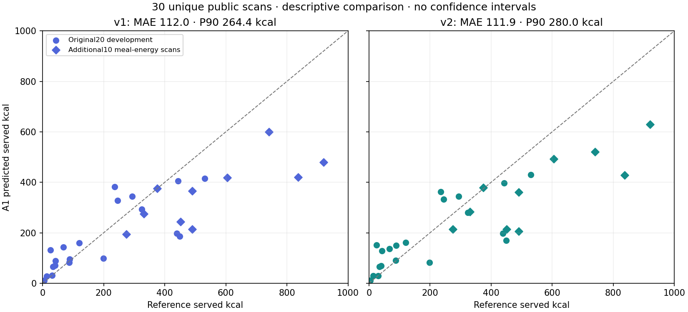

# Thirty public scans: measured baseline and catalog decision

**The expanded catalog did not establish a consistent calorie-accuracy improvement. The active source default is restored to the deployed six-record baseline; the73-record candidate is archived and reproducible.** No phone installation, owner measurements or cloud deployment is needed for this work.

Both frozen versions now have actual predictions for30 unique public Nutrition5k scan IDs. This is20 original development cases plus10 additional energy-stratified cases, **not30 independent completed meals or30 owner Android meals**. References are the dataset's measured-component masses and original recipe/database-derived served nutrients; no model output supplied reference labels.

| Scope/version | A1 kcal MAE | Signed bias | P90 absolute error | Mean normalized absolute error |
|---|---:|---:|---:|---:|
| Original20, six records |71.54|−7.77|155.45|24.89%|
| Original20,73 records |78.05|−4.75|137.80|27.99%|
| Additional10, six records |192.99|−192.95|420.00|32.13%|
| Additional10,73 records |179.68|−178.84|303.16|30.34%|
| **Combined30, six records** |**112.02**|**−69.49**|**264.44**|**27.30%**|
| Combined30,73 records |111.93|−62.78|280.01|28.77%|

Normalized error divides by max(reference,200kcal); it is not a percentage-accuracy claim. P90 uses linear interpolation over the actual errors within each scope. Combined P90 is **not** an average of cohort P90s. These observations are not per-meal uncertainty bands.

Across30 paired A1 cases, candidate absolute error improved in11, worsened in16, and was unchanged in3. Its mean difference was−0.095kcal; overall P90 and normalized error worsened. The additional10 split5 improved/5 worsened. Broader attribution and lower error on one stratum do not establish an overall accuracy gain.

## What the new cases resolve

The first20 had12 references below200kcal, eight200–600, and none above600. Before downloading new images, the extension froze10 IDs with at least two reference ingredients and150g: four600–1000kcal, three400–600, three200–400. Actual selected references span approximately274–920kcal. Every selected image produced one valid A1 estimate per engine; no replacement, retry, fallback or failed case was discarded.

The deployed baseline underpredicted all four new >600kcal references; their MAE/bias magnitude was296.50kcal. On the additional10, mass MAE was131.7g and bias−131.5g. The73-record candidate also underpredicted these higher-energy cases. Portions, food identities and preparation/density discrepancies remain relevant; these aggregate measurements do not establish a causal fix or validate depth, calibration, or an oracle-weight predictor.

Combined sample composition is12 under200kcal,14 from200–600 and4 above600. Energy stratification deliberately changes the evaluation distribution. Report the scopes above rather than treating the combined mean as a representative population score.

## A0 and nutrient attribution

A0 full-image coverage changed from**1/30 to7/30**. For the seven candidate-covered images only, A0 MAE203.23kcal versus A1 MAE104.07. Twenty-three candidate images still contain an unmatched component. A0 shares A1 identities/preparation and tests generic serving priors; it is not an independent recognition system. Neither changing subsets nor this coverage level supports an overall A0/A1 or A0-version ranking.

Unverified model densities supplied89.51% of baseline predicted energy and62.66% of candidate energy. This measures nutrient provenance, not unexplained statistical variance or food-recognition accuracy. A real database record does not verify the pictured food, its preparation or its estimated grams. Unknown recipes remain explicitly unverified.

Each additional10 run requested**one unanswered preparation question**; zero questions were answered. The original20 requested none. No hidden recipe/weight information answered a question or entered inference. An early review prompt mistakenly said zero new questions; raw summaries were correct and the independent audit caught the statement. The report uses the actual counts.

All60 public prediction receipts (30 per version),148 component nutrient vectors, all A0 prior calculations,30 original source rows and all published CSV/metric values were independently reconstructed without discrepancy. SDK latency and recorded tokens are available in the summary; full billed cost, phone capture-to-estimate timing and systematic missing/spurious-food annotations remain unknown. No manual corrections were substituted into automatic predictions.

## Reproducible execution and source decision

The [frozen new manifest](../../functions/eval/tier1-public/manifest-mealrange-v1.json) contains source/reference/image hashes and selection rules. Eligibility used official overhead-available RGB TEST, excluding76 legacy IDs/their42 dates and the recent20 IDs. The valid meal-energy pool contained47 scans across19 dates. Seed `calorix-tier1-mealrange-20261108-v1` ranks dates then IDs within high→mid→low quotas, using10 distinct dates. Seven dates overlap the earlier cohort; total distinct dates are23. Incremental dish scans and unknown closed-model pretraining exposure preclude independent-plate or fresh-heldout claims.

Ten PNGs were individually converted with Pillow11.1.0 to RGB JPEG85/subsampling2, no resize, empty EXIF. Independent audit verified every source row, quota/exclusion/rank, original/input hash,640×480 dimensions and byte-exact conversion. Selection preceded image downloads. Host viewed all10 input thumbnails after freezing; numeric auditor viewed no photos. No exhaustive visual recognition or UI-diff audit is claimed (diff statuses/sources, `auditLimited`, `visualClassificationStatus`: not applicable).

`tool/run_frozen_public_eval.cjs` reconstructs five modules directly from frozen Git versions**0bf1f96** and**842b208**, checking source/compiled bytes, direct installed dependency/TypeScript versions, dependency path, committed clean manifest, consent and fresh run/control paths before inference. Each unchanged engine made10 new calls; source/manifest controls are retained. Model remains `gemini-3.8-flash`, SDK2.19.0, Vertex US, LOW,8192output cap,30s timeout, one attempt, no model fallback. Dependency checks do not attest every installed transitive package byte.

The73-record catalog remains [an archived candidate](../../functions/eval/tier1-public/catalog-v2.json), with all292 USDA nutrient values and source provenance retained. Production `tier1-catalog.ts` is byte-identical to verified0bf1f96; a new regression first failed with73 active records, then passed when candidate-only IDs were refused by active reconciliation/A0. The historical candidate positive integration and complete engine remain reproducible at842b208. No post-result catalog/model tuning or cloud mutation occurred.

[Verification receipt](verification.md) records full CI, TDD and review scope. [Machine-readable summary](summary.json) and [all30 numeric rows](cases.csv) retain cohort separation, failures, macros/mass, provenance hashes, latency and token observations. Raw photos/responses/control logs stay outside Git. Owner Android weighed references remain**0/30**, deliberately separate and not a prerequisite for this public evaluation.

Data attribution: Thames et al., *Nutrition5k*, CVPR2021, [official dataset](https://github.com/google-research-datasets/Nutrition5k), [CC BY4.0](https://creativecommons.org/licenses/by/4.0/); USDA [FoodData Central SR Legacy](https://fdc.nal.usda.gov/download-datasets/) nutrient records.
