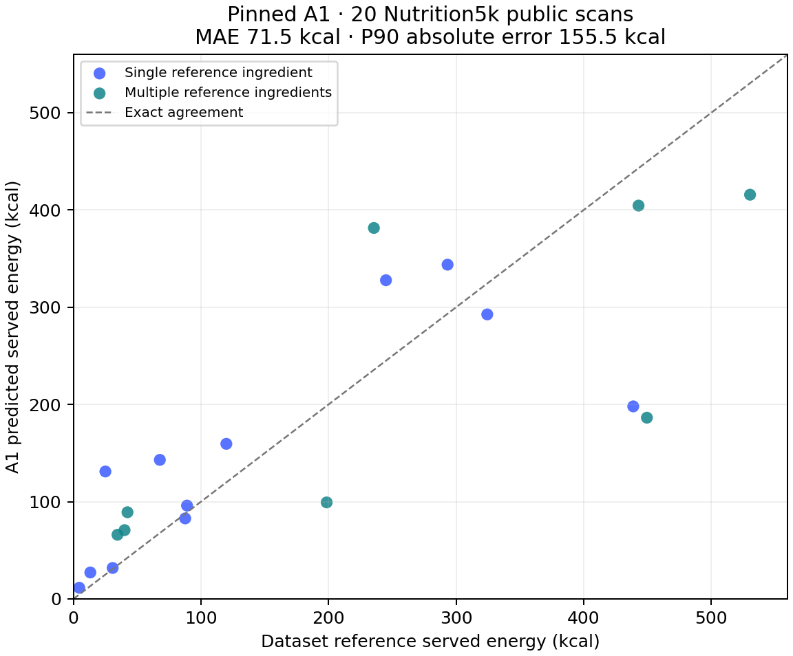

# First measured public benchmark — 2026-11-08

**Actual run completed:20 selected public images,20 SDK invocations,20 valid A1 estimates,zero inference/data failures,zero retries,zero model substitutions.** Execution commit `0bf1369b7e1d14e8f5316d505d7007c671119a57`; fixed `gemini-3.8-flash`, LOW,8192 output-token cap,30s request timeout, SDK2.19.0. The compiled inference module matched the deployed Tier1 module. No production deployment was made for this evaluation.

The two owner-phone screenshots additionally demonstrate returned/saved real-food estimates. They have no independent weights and are **functional evidence only**. Neither value can be judged accurate from the screenshots.

## Observed results

| Metric | A1 result |
|---|---:|
| Valid automatic estimates | 20/20 |
| Mean absolute served-kcal error | **71.54 kcal** |
| Mean signed error, predicted minus reference | −7.77 kcal |
| P90 absolute error, linear interpolation | **155.45 kcal** |
| Mean normalized absolute error, denominator max(reference,200kcal) | 24.89% |
| Protein / carbs / fat MAE | 5.43 / 5.10 / 4.72g |
| Portion-mass MAE | 49.60g |
| Single-reference-ingredient kcal MAE,12cases | 55.03 kcal |
| Multiple-reference-ingredient kcal MAE,8cases | 96.30 kcal |
| Under200kcal references,12cases: kcal MAE | 38.55 kcal |
| 200–600kcal references,8cases: kcal MAE | **121.02 kcal** |

The small signed bias hides larger individual errors. The normalized metric is **not ordinary MAPE** and is not a percentage-accuracy claim. These errors are observations on this sample, not per-meal uncertainty intervals.

The three largest absolute errors were:

| Dataset scan | Reference → A1 | Absolute kcal error |
|---|---:|---:|
| dish_1566920339 | 449.53 → 186.40 | 263.13 |
| dish_1563389548 | 438.83 → 198.00 | 240.83 |
| dish_1564675411 | 235.53 → 381.50 | 145.97 |

## Baseline and nutrient-source gaps

A0 produced an answer for **1/20 cases (5%)**. The other19 were explicit catalog-coverage failures because the current catalog contains only six nutrient records and A0 does not invent replacements. Both routes share A1 food identities/preparation and the same catalog. No overall A0/A1 ranking is supportable. On the sole paired case, reference438.828kcal, A0247.5, A1198.0; this one pair does not establish a winner.

A1 produced39 components: six nutrient-record matches and33 explicitly unverified model-density estimates. **3,039.86 of3,558.26 predicted kcal (85.43%)** came from those unverified densities. A database record match also does not verify visual food identity, preparation or portion mass. The current system therefore relies heavily on model nutrient estimates despite having a database route.

No preparation question was requested in these20 responses. No question was answered from reference ingredients/weights. Missing/spurious-food counts were not systematically annotated and remain unknown; valid JSON/response coverage does not mean every ingredient was recognized. Manual corrections:0.

SDK latency on this run: median10.75s, P9012.83s. These are model-call timings, not Android shutter-to-estimate or user-interaction measurements. Recorded usage:40,360 prompt tokens and6,218 candidate tokens; thought/failure/billing usage is incomplete and billed cost remains **unknown**, not zero.

## Frozen data protocol

References are original **Nutrition5k** measured-component masses and recipe/database-derived kcal/macros; no labels were recomputed from predictions. They are not chemical-calorimetry measurements. Source: Thames et al., *Nutrition5k*, CVPR2021, [official dataset](https://github.com/google-research-datasets/Nutrition5k), [CC BY4.0](https://creativecommons.org/licenses/by/4.0/).

- Sampling frame:507 official overhead-available TEST scan IDs, all within official RGB TEST; **only RGB** was used. No depth, second view, label or weight was supplied to the model.
- Exclude76 IDs from prior committed public/calibration/development manifests and their42 UTC capture dates. Independent metadata audit found141 eligible scans across25 remaining dates after deprecated/invalid/inconsistent source records were excluded.
- Before any image/model outcome, SHA256-rank dates using `calorix-tier1-public-v1-20261108`, then rank IDs within date; select20 dates/one scan each. No post-result replacement. Source selection history and checksums retained.
- All20 references and row hashes were independently matched to original CSVs; all original/JPEG hashes, dimensions and empty EXIF were independently checked. The README's singular vocabulary URL returned404; provenance was corrected to the actual plural `metadata/ingredients_metadata.csv` before inference, preserving every selected ID, label and image byte. Original snapshots/correction receipt retained.
- Inputs:640×480 original PNGs converted with Pillow11.1.0 to RGB JPEG85,4:2:0,empty EXIF,no resizing. Original and model-input hashes are in [the frozen manifest](../../functions/eval/tier1-public/manifest-v1.json).
- Model received only that single JPEG and the unchanged production prompt. No reference names, calories, weights or preparation answers were supplied. Sequential once-only execution; infrastructure failures would halt, and all selected cases remain in coverage denominators.

This is a **20-scan exploratory sample**, range4.6–530.39kcal;12 cases below200kcal, eight from200–600, **none above600**. Date thinning is a heuristic, not proof of independent completed plates. Nutrition5k includes incremental food scans; do not describe these as20 independently completed meals. Closed-model pretraining exposure is unknown. No confidence intervals, broad accuracy qualification, personal-phone calorie validation or consumed-energy claim follows.

## Evidence and engineering decision

[Machine-readable summary](summary.json) and [all20 numeric rows](cases.csv) include reference/predicted kcal,macros,mass, failures, context/input/reference/receipt hashes and token/latency observations. Raw responses/photos/console remain outside Git as identified local evidence. An independent read-only reviewer recomputed all20 outputs and all39 component totals with no mismatch. Host inspected all20 input thumbnails; no exhaustive full-resolution visual or UI-diff audit is claimed (`auditLimited`, `visualClassificationStatus`, diff counts: not applicable).

The measured engineering gap is **nutrient-record coverage and matching**: the current six-record catalog does not support a meaningful A0 comparison and leaves most A1 energy based on unverified model densities. Any expanded-catalog baseline should receive a new version and separate evaluation; this frozen run must remain unchanged. This result does not establish which portion architecture would improve accuracy.

**Owner/Android physically weighed pilot remains0/30. Public evaluation is useful now and is not blocked on collecting those meals.** The public dataset's real labels provide the measurements above; the owner's two scans provide additional functional evidence.

[Final build, test, review and Samsung number-display verification; updated APK](verification.md).
